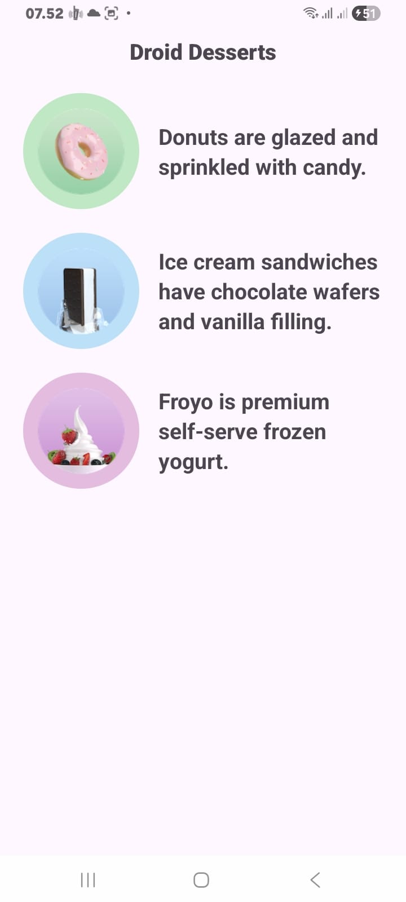
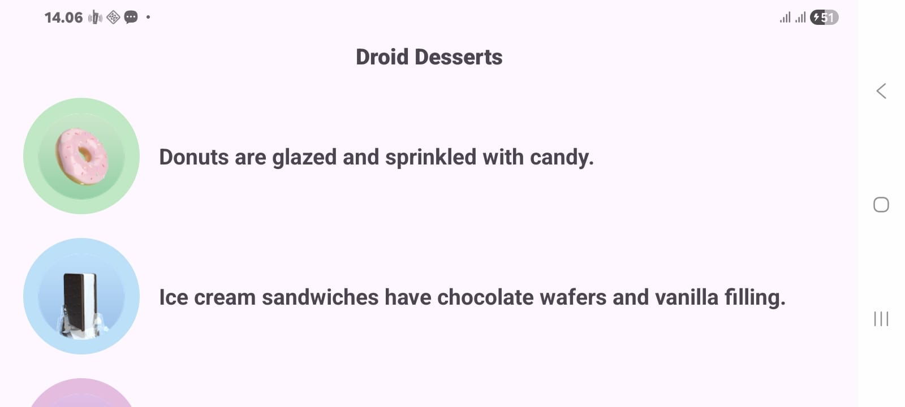

# DessertRecycleView

Project praktikum **Pengembangan Aplikasi Mobile (PAM)**, Pertemuan 6: *RecyclerView & Adaptive Layout*, **Modul 2**.

Aplikasi Android yang menampilkan daftar dessert (**Donut**, **Ice Cream Sandwich**, dan **Froyo**) menggunakan `RecyclerView`. Setiap baris berisi gambar bulat dengan warna latar berbeda beserta deskripsinya. Project ini merupakan pengembangan tampilan *Droid Desserts* yang sebelumnya dibuat dengan `ImageView` statis, kini diubah menjadi daftar dinamis.

## Identitas

| | |
|---|---|
| **Nama** | Fadhillah Rizqia Arfin |
| **NIM** | 1237050056 |
| **Mata Kuliah** | Pengembangan Aplikasi Mobile |

## Fitur

- Menampilkan daftar dessert dengan `RecyclerView` dan `LinearLayoutManager`.
- Tampilan satu baris dibuat terpisah di `itemdesert.xml` (gambar bulat + deskripsi).
- Warna lingkaran latar gambar diatur secara dinamis lewat `GradientDrawable` berdasarkan kode warna HEX pada data.
- Data dimodelkan dengan `data class` Kotlin (`Dessert`).

## Tampilan

<p align="center">
  
</p>

<p align="center">
  
</p>

*Hasil aplikasi saat dijalankan di perangkat: tiga dessert dengan lingkaran latar hijau, biru, dan ungu.*

## Data Dessert

| Dessert | Gambar | Warna Latar |
|---|---|---|
| Donuts | `donut_circle` | `#C1E8C5` (hijau) |
| Ice Cream Sandwich | `icecream_circle` | `#BBE0F8` (biru) |
| Froyo | `froyo_circle` | `#E4BCDF` (ungu) |

## Struktur Project

```
app/src/main/
├── java/lat/pam/dessertrecycleview/
│   ├── MainActivity.kt
│   ├── Dessert.kt
│   └── DessertAdapter.kt
└── res/
    ├── layout/
    │   ├── activity_main.xml
    │   └── itemdesert.xml
    └── drawable/
        ├── circle_background.xml
        ├── donut_circle.png
        ├── icecream_circle.png
        └── froyo_circle.png
```

## Penjelasan Komponen

| File | Fungsi |
|---|---|
| `Dessert.kt` | Model data berisi deskripsi, gambar, dan kode warna latar. |
| `itemdesert.xml` | Layout satu baris: `FrameLayout` bulat berisi `ImageView`, di samping `TextView` deskripsi. |
| `circle_background.xml` | Bentuk lingkaran (`oval`) sebagai latar default gambar. |
| `DessertAdapter.kt` | Mengisi teks dan gambar tiap baris, serta mengubah warna lingkaran secara dinamis. |
| `activity_main.xml` | Layout utama berisi judul "Droid Desserts" dan `RecyclerView`. |
| `MainActivity.kt` | Menyiapkan daftar dessert dan memasang adapter ke `RecyclerView`. |

## Teknologi

- Kotlin
- Android Studio
- Minimum SDK: API 27 (Android 8.1 "Oreo")
- `RecyclerView` dan `CoordinatorLayout` (AndroidX)

## Cara Menjalankan

1. Clone repository ini:
   ```bash
   git clone https://github.com/Fadhillahrizqia/DessertRecycleView.git
   ```
2. Buka Android Studio, pilih **File > Open**, lalu pilih folder `DessertRecycleView` (folder yang berisi `app`, `gradle`, dan `settings.gradle.kts`, bukan folder induknya).
3. Tunggu proses Gradle sync selesai.
4. Pilih emulator atau HP (USB debugging aktif), lalu klik **Run**.

## Catatan

- Gambar dessert (`donut_circle`, `icecream_circle`, `froyo_circle`) diambil dari repository contoh Google Developer Training (DroidCafe).
- Nama package pada file Kotlin disamakan dengan package project (`lat.pam.dessertrecycleview`).
- Teks sisa `[cite: 1]` pada komentar di `MainActivity.kt` dan `import` yang tidak terpakai dibersihkan.
